# Wolf Algorithm Optimization of ICEEMDAN Parameters, Four Different Fitness Functions Optionally Switched, Minimize Envelope Entropy, Sample Entropy, Information Entropy, Arrangement Entropy

Today, we bring you a MATLAB code for optimizing the parameters of ICEEMDAN using the Gray Wolf Algorithm. The optimization idea can be referred to this paper:
[1] Chen Aiwu, Wang Hongwei. Planetary Gearbox Fault Diagnosis Based on HBA-ICEEMDAN and HWPE [J]. Mechanical Engineering, 2023, 40(08):1157-1166.
The paper mentions that the decomposition effect of the ICEEMDAN method depends on the white noise amplitude weight (Nstd) and the number of noise additions (NE). Therefore, the author used an intelligent optimization algorithm to optimize two parameters of ICEEMDAN, with the fitness function adopting Entropy envelope. The smaller the fitness value, the better the decomposition effect; through optimization and updating, the final optimal parameter combination (Nstd, NE) is determined.
This article takes the Xichu University dataset as an example, selecting 1000 data points from X105_BA_time.mat. For those without data, please read this article. Xichu University Bearing Diagnosis Data Processing, MATLAB Free Code Available
We selected four types of fitness functions for optimization, allowing any switching, and used the Gray Wolf Algorithm to optimize ICEEMDAN, optimizing 30 times, with a population size of 10. The range of optimization for the white noise amplitude weight was set to [0.15,0.6], and the range of noise additions was set to [50,600], thereby determining the white noise amplitude weight (Nstd) and noise additions (NE) of ICEEMDAN.
The four types of fitness functions are: minimum Entropy Envelope, minimum Sample Entropy, minimum Information Entropy, and minimum Arrangement Entropy. The code allows one-click switching among these.
1. Minimum Entropy Envelope as the fitness function
The optimization process is as follows:
The results are as follows:
2. Minimum Sample Entropy as the fitness function
3. Minimum Information Entropy as the fitness function
4. Minimum Arrangement Entropy as the fitness function
Code:
%% Optimize ICEEMDAN with the objective functions of minimum entropies (minimum entropy, minimum sample entropy, minimum information entropy, and minimum permutation entropy) using GWO algorithm.\nclear\nclc\nclose all\nxz = 1;  %xz, select 1, using minimum entropic fitness as the fitness function.\n% Select 2, using the minimum sample entropy as the fitness function.\n% Select 3, using the minimum information entropy as the fitness function.\n% Select 4, using the minimum arrangement entropy as the fitness function.\nif xz == 1  \n    fobj=@EnvelopeEntropyCost;          % Minimum Entropy\nelseif xz == 2\n    fobj=@SampleEntropyCost;            % Minimum sample entropy\nelseif xz == 3  \n    fobj=@infoEntropyCost;              % Minimum Entropy\nelseif xz == 4\n    fobj=@PermutationEntropyCost;       % Minimum Arrangement Entropy\nend\n​\n%% Selection of data\nload 105.mat\nda = X105_DE_time(6001:7000); % Here, select the DEtime data of 105, note that you can replace this with your own data. The data format is n rows * 1 column, and the number of columns must be 1.\n​\n%% Set parameters\nlb = [0.15 50];    %The range of optimization for noise amplitude weight is set to [0.15, 0.6], and the range of optimization for noise addition times is set to [50, 600].\nub = [0.6 600];  \ndim = 2;            % Optimize the number of variables\nMax_iter=30;       % Maximum number of iterations\nSearchAgents_no=10;       %Population size\n​\n%% Call GWO function\ndisp('The code takes a long time to run, please wait patiently.! ')\n[fMin , bestX, Convergence_curve ] = GWO(SearchAgents_no,Max_iter,lb,ub,dim,fobj,da);\n​\n%% Plot the fitness function curve and output the optimal parameters.\nfigure\nplot(Convergence_curve,'Color',[0.9 0.5 0.1],'Marker','>','LineStyle','--','linewidth',1);\ntitle('Objective space')\nxlabel('Iteration');\nylabel('Best score obtained so far');\nlegend('GWOOptimizationICEEMDAN')\ndisp(['The best solution obtained by GWO is : [',num2str(bestX(1)),',',num2str(fix(bestX(2))),']']);  % Output the best location\ndisp(['The best optimal value of the objective funciton found by GWO is : ', num2str(fMin)]);  % Output the best fitness value\nEveryone, pay attention to see.xzThis variable, when selected.1, Using the minimal entropic fitness function, select.2, Using the minimum sample entropy as the fitness function, select.3, The fitness function is the minimum information entropy, and selection is made.4, Use the minimum permutation entropy as the fitness function. This makes it very convenient for everyone to switch.。  
The code directory is as follows:
Here, I briefly mention a MATLAB tip: right-click on "Name" in MATLAB and select "Group by Type". This will automatically group all files in the current folder by type. At this point, you can clearly see which files belong to functions and which to scripts. Generally speaking, scripts are executable, while functions are not. This makes it very user-friendly for beginners!

## Images

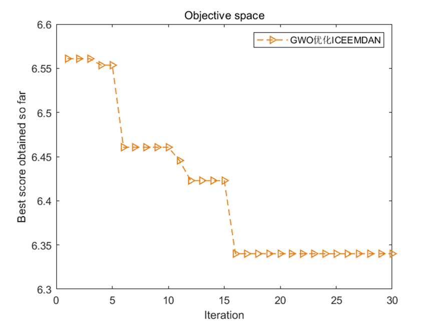
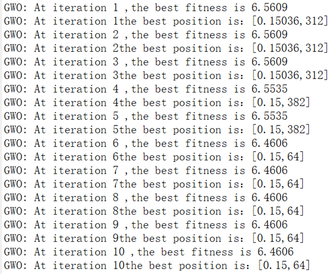
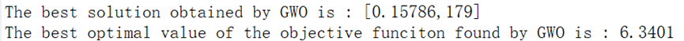
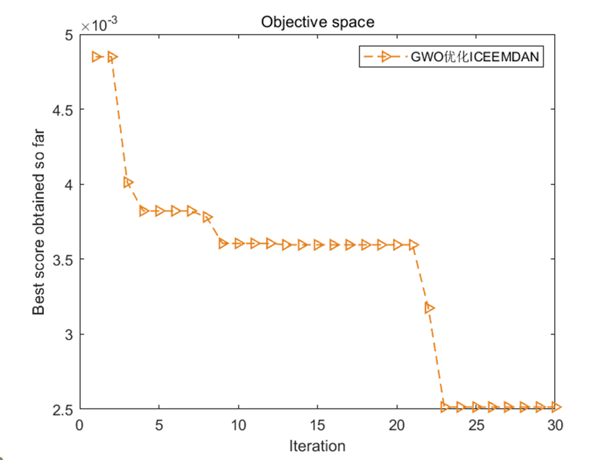
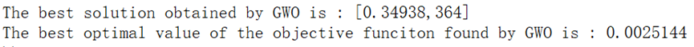
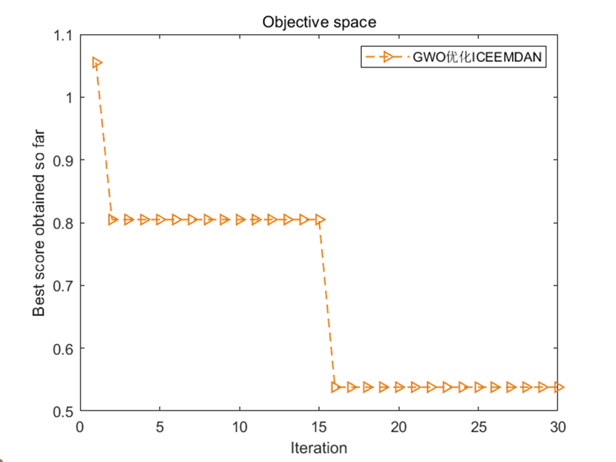
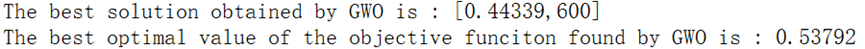
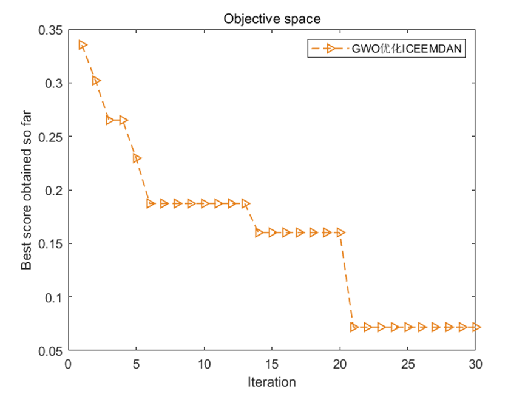
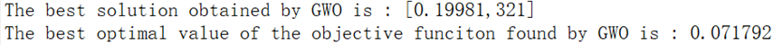
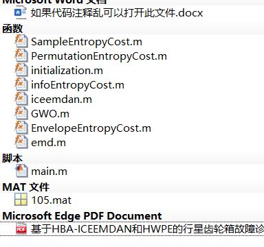
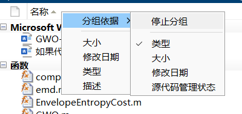

<!-- PAYMENT_BLOCK -->

## Get this dataset

- Payment link (Stripe): [Buy now](https://buy.stripe.com/3cs8yP7sY87d0vu9AB)
- Payment QR code: 

<!-- /PAYMENT_BLOCK -->
